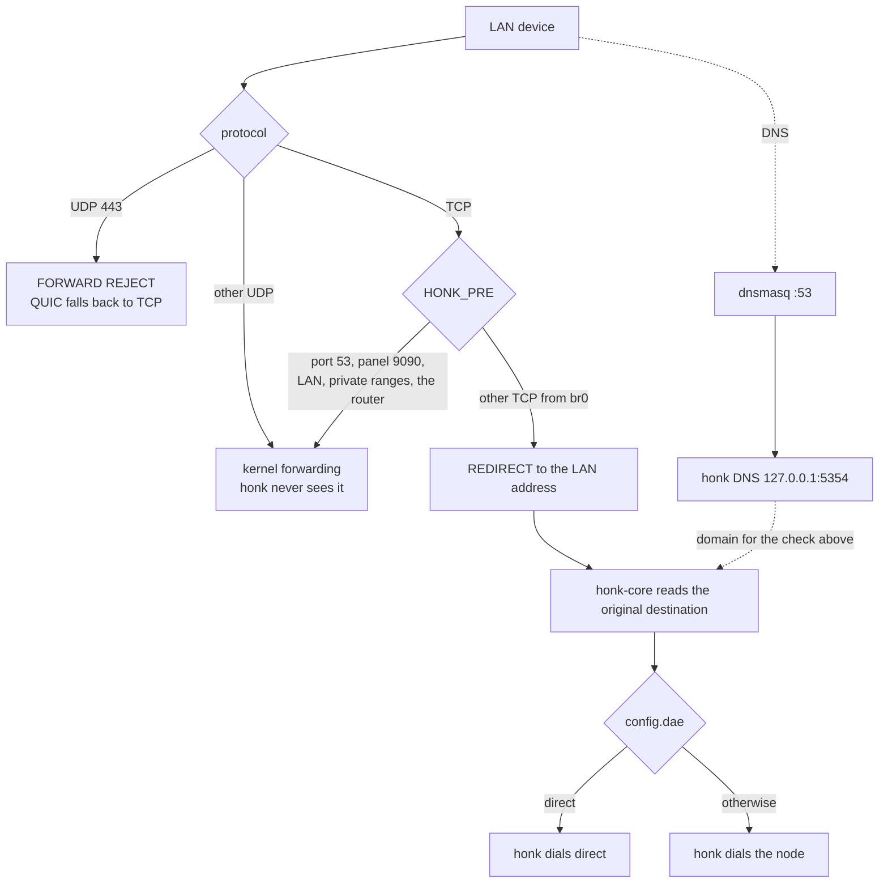

# honk for the RT-BE88U

**An Asuswrt-Merlin addon that runs honk on the RT-BE88U.**

[简体中文](README.zh.md)

The router page only starts, restarts, and stops honk. Subscriptions, nodes, groups, rules, and the configuration are edited in doona, not on this page.

Captured on an RT-BE88U in wireless-router mode, firmware 3006.102.9. The tab is Administration → Honk.

## What is running

`honk-core` listens on the LAN address. The TCP port is `tproxy_port`, or 12345 when that field is absent. The name is historical: this kernel is not using TPROXY, and this build does not load eBPF.

iptables only decides which packets reach that process. It does not choose direct versus proxy.

`HONK_PRE` returns `10.0.0.0/8`, `172.16.0.0/12`, `192.168.0.0/16`, and `100.64.0.0/10` before the REDIRECT. IPv6 is not intercepted. dnsmasq forwards to `127.0.0.1#5354` because 5353 is avahi. `honk_install` does not copy `dnsmasq.postconf` into `/jffs/scripts`.

Boot does not arm the intercept. Stop removes it and restores Broadcom flow cache. nvram is not edited.

## Page

| | |
|---|---|
| Buttons | 启动, 重启, 关闭 |
| Panel | doona on port 9090 |
| Config | `/jffs/addons/honk/config.dae`, which includes `nodes.dae` |

## Docs

Operator steps are in [merlin/README_merlin.md](merlin/README_merlin.md). The short addon note is [merlin/README.md](merlin/README.md). The config schema is [docs/merlin-config.md](docs/merlin-config.md).

`sh merlin/build.sh` writes `merlin/dist/honk-be88u.tar.gz`: a static `aarch64-unknown-linux-musl` `honk-core` without eBPF, the UI, `geoip.dat`, `geosite.dat`, the scripts, and this page.

## License

[GPL-3.0-only](LICENSE). The engine is [honk](https://github.com/daeuniverse/honk).
