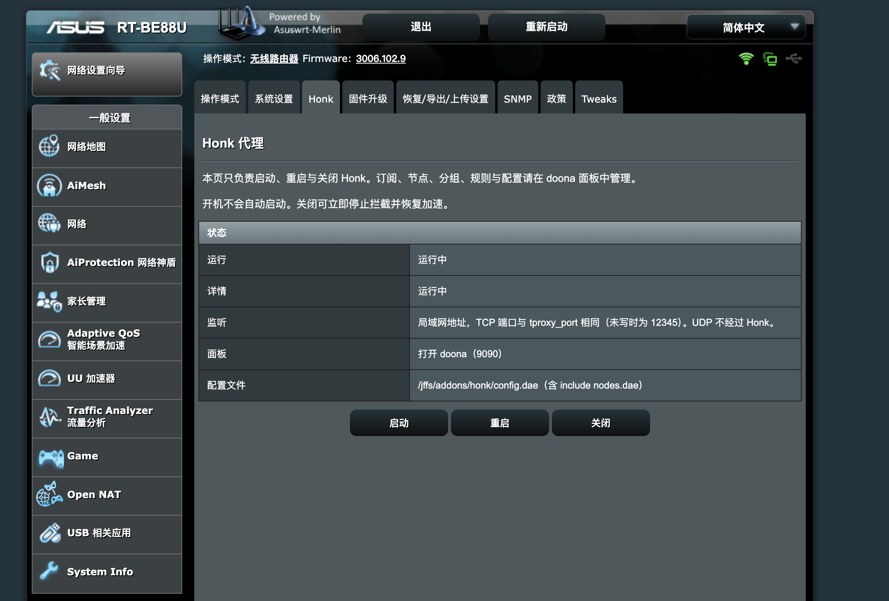
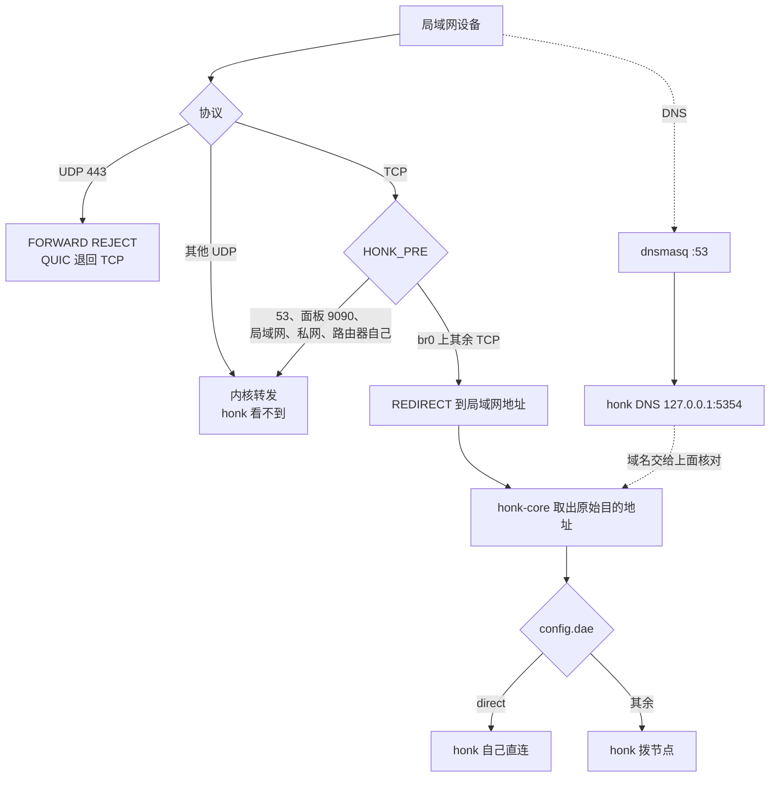

# honk for the RT-BE88U

**跑在 RT-BE88U 上的 Asuswrt-Merlin 插件。**

[English](README.md)

路由器上的这个页面只负责启动、重启和关闭。订阅、节点、分组、规则和配置在 doona 里改，不在这一页。

截自无线路由器模式的 RT-BE88U，固件 3006.102.9。页签在「系统管理 → Honk」。

## 现在实际在跑的

`honk-core` 听在局域网地址上。TCP 端口是 `tproxy_port`，没写就是 12345。这个名字是旧的：这台内核没有在用 TPROXY，这个构建也不加载 eBPF。

iptables 只决定哪些包能进这个进程。直连还是走节点，不是它判的。

`HONK_PRE` 在 REDIRECT 之前放行 `10.0.0.0/8`、`172.16.0.0/12`、`192.168.0.0/16` 和 `100.64.0.0/10`。IPv6 不拦截。dnsmasq 把 DNS 转到 `127.0.0.1#5354`，因为 5353 是 avahi。`honk_install` 不会把 `dnsmasq.postconf` 拷进 `/jffs/scripts`。

开机不会自动启动。关闭会摘掉拦截，并恢复 Broadcom flow cache。不改 nvram。

## 页面

| | |
|---|---|
| 按钮 | 启动、重启、关闭 |
| 面板 | doona，端口 9090 |
| 配置 | `/jffs/addons/honk/config.dae`，其中 include `nodes.dae` |

## 文档

操作步骤在 [merlin/README_merlin.md](merlin/README_merlin.md)。插件短说明在 [merlin/README.md](merlin/README.md)。配置字段在 [docs/merlin-config.md](docs/merlin-config.md)。

`sh merlin/build.sh` 产出 `merlin/dist/honk-be88u.tar.gz`：不带 eBPF 的静态 `aarch64-unknown-linux-musl` `honk-core`、界面、`geoip.dat`、`geosite.dat`、脚本和这个页面。

## 许可证

[GPL-3.0-only](LICENSE)。引擎是 [honk](https://github.com/daeuniverse/honk)。
