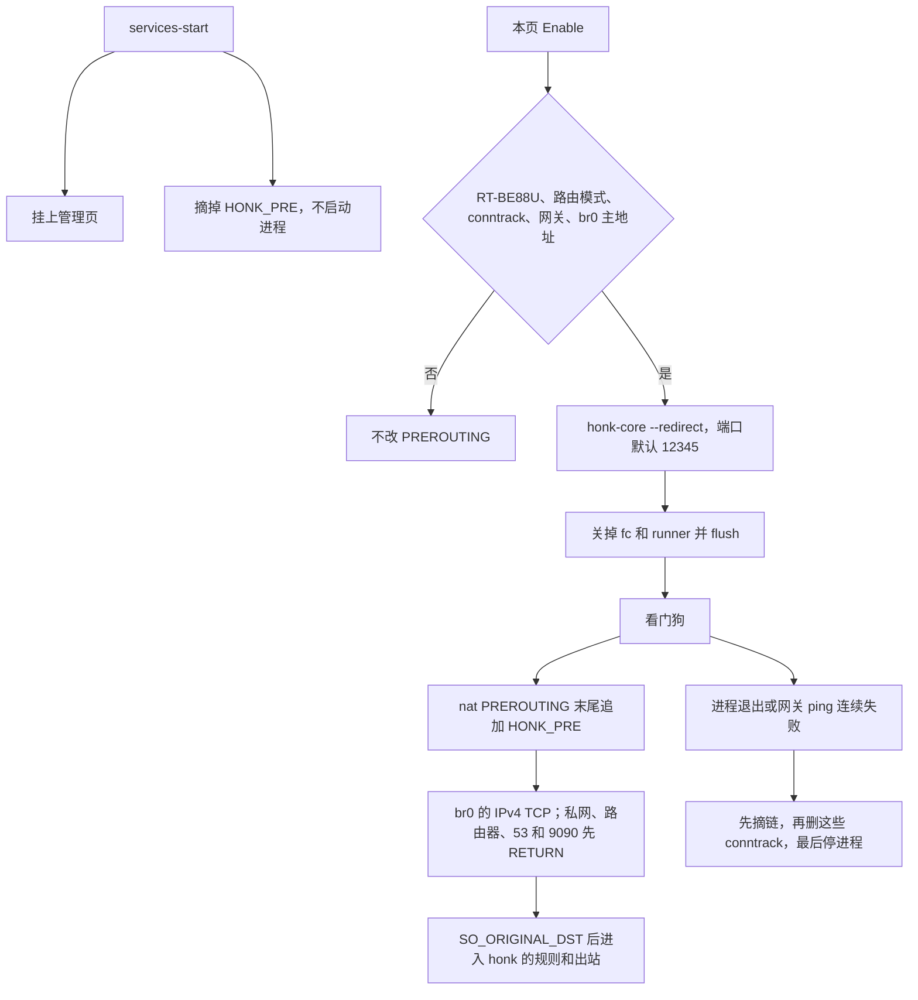

# honk on RT-BE88U（Asuswrt-Merlin）

这是把上游 `honk-core` 接到 RT-BE88U 的插件。eBPF 不参与。Broadcom 4.19 上由 iptables 把局域网的 IPv4 TCP REDIRECT 到 `honk-core --redirect`，再按 `config.dae` 里的规则、策略组和节点转发。UDP 不进 REDIRECT。`firewall-start` 在 FORWARD 拒绝局域网 UDP/443，让 QUIC 回落到这条 TCP。其它 UDP 不代理。启动期间会关掉 Broadcom flow cache，关闭时恢复。

## 已核对的平台

公开资料，不是在这台路由器上测到的：

- SNBForums 上的 amtm 输出：`ASUS RT-BE88U HW: aarch64 Kernel: 4.19.294`，固件 `3006.102.3`。
- Merlin `release/src/router/Makefile`：`HND_ROUTER_BE_4916` 默认 `LINUX_KERNEL=4.19.235`；只有 `ASUSWRT_BRCM_SDK_VERSION` 为 `WIFI7_SDK_20250506` 时才是 `5.15.167`。
- Merlin 树里的 `release/src-rt-5.04behnd.4916/kernel/linux-4.19/config_base.6a.6813` 文件头是 `Linux/arm64 4.19.294`。其中 `CONFIG_BPF=y`，但 `CONFIG_BPF_SYSCALL`、`CONFIG_CGROUPS`、`CONFIG_NAMESPACES` 都未打开。`CONFIG_IP_NF_TARGET_REDIRECT=y`。`CONFIG_NETFILTER_XT_TARGET_TPROXY=m`，同时 `CONFIG_NF_TPROXY_IPV4` 未打开，所以不能把 TPROXY 当成可用。`CONFIG_TUN=m`。`CONFIG_NF_CT_NETLINK=y`，`CONFIG_IKCONFIG_PROC=y`。
- 插件页用的是 Merlin `helper.sh` 的 `am_get_webui_page` / `am_settings_set`，以及 `services-start`、`nat-start`、`firewall-start`、`service-event`。当前 `menuTree.js` 里没有 `Tools_OtherSettings.asp`。页签插在只出现一次的 `url: "Advanced_System_Content.asp"` 后面。3006.102 的 `menuTree.js` 用数字词典，例如 `<#613#>`，不要求 `<#menu5_6_2#>`。这一行不是恰好一次时，安装记 `menu_anchor_not_found` 并且不会报 `installed`。
- `service-event` 里的 ash 没有 `command`，裸文件名的 `[ -x ]` 也不会搜 PATH。conntrack、iptables、ip、nvram、ping、curl、logger 在 `/usr/sbin`、`/usr/bin`、`/sbin`、`/opt/sbin`、`/opt/bin` 里按绝对路径查找。Enable 被拒绝时，页面重新载入并显示原因，例如 conntrack 不可用。
- 必须已有 `config.dae`。Enable 启动 `honk-core -c config.dae --redirect <局域网地址>:<tproxy_port>`。订阅由 honk-core 用自己的 User-Agent 拉取，内容是 base64 的 `ss://` 列表。面板是 `http://192.168.2.1:9090/ui/`，安装包里已经放好界面文件。解除时只按 pid 文件结束监听和看门狗，conntrack 删除最多等几秒。

CPU 是 aarch64。交叉编译目标是 `aarch64-unknown-linux-musl`。

## 架构



`nat-start` 只有在这次开机已经武装过时才会重新挂上链。它不读网页里保存的开关。`firewall-start` 的参数是 WAN 口，不拿它当局域网桥，也不改 NAT。它按 `lan_ifname` 在 FORWARD 拒绝局域网 UDP/443。

路由器自己发出的包不进 `PREROUTING`，所以没有 OUTPUT 规则，也没有 `ip rule`。REDIRECT 在 PREROUTING 上会把目的地址改成入接口的主地址，不是 127.0.0.1，所以进程绑在 `lan_ipaddr` 上。

## 这一阶段做了什么

| 项 | 状态 |
| --- | --- |
| 内核配置探测：eBPF 偏好与 Merlin 安装动作分开 | 已实现，有测试 |
| IPv4 TCP REDIRECT 计划：先写满排除规则，最后才挂到 PREROUTING | 已实现，有测试 |
| 绑定 LAN 主地址，读 `SO_ORIGINAL_DST`，失败就关掉这条连接 | 已实现 |
| 把字节拷到原始目的地址 | 已实现。这不是代理 |
| 开机默认关闭；启动即视为已确认，不再倒计时。网关 ping、进程退出后摘链 | 已实现，脚本测试 |
| 按 conntrack 原始元组删除被 REDIRECT 的流，不做 `conntrack -F` | 计划已按抓到的 `/proc/net/nf_conntrack` 行测试。本环境的 conntrack netlink 调用失败，删除命令没有在内核里跑通 |
| 管理页，沿用 FormTitle / FormTable / button_gen | 已实现。没有在浏览器里打开过 Merlin |
| 安装、卸载、`service-event` | 已实现，脚本测试 |
| aarch64 musl 交叉编译 | 有 `merlin/build.sh` 和 `.github/workflows/merlin.yml` |
| 通过 honk-outbound 拨代理节点 | 未接。`dial_honk_outbound` 固定返回错误，接受连接的路径不会调用它 |
| UDP、TUN、TPROXY | UDP 不进 REDIRECT。`firewall-start` 拒绝局域网 UDP/443。TUN、TPROXY 不安装 |
| 启动 `honk-core` 的 eBPF | 不做 |
| IPv6、访客网络桥 | 不拦截，直接通过 |
| Broadcom flow cache / runner | 不改 nvram，不在运行时关闭 |

本仓库里没有 OpenWrt LuCI 页面。OpenWrt 只出现在 BTF 和安装说明里，那些说明没有删。

## 安全边界

- 每次开机 `services-start` 都会摘链并清掉 `/tmp` 里的武装标记。保存过的设置不会在开机后自动拦截。
- Enable 之前要同时满足：`productid` 或 `odmpid` 是 `RT-BE88U`，`sw_mode=1`，`conntrack -C` 成功，WAN 网关是一个 IPv4 地址，`lan_ifname` 的主地址等于 `lan_ipaddr`。
- 链里的规则都带 `-i` 局域网接口和 `-p tcp`。目的地址属于局域网、路由器自己的地址、127/8、169.254/16、224/4 或 255.255.255.255 时 RETURN。
- 启动会立刻写下已确认标记并删掉倒计时。进程退出和 ping 失败仍然会摘链。
- 路由器上的 ping 不经过这条 PREROUTING 规则，它不能证明局域网电脑还能上网。用局域网客户端检查。页面没有确认按钮。
- 卸载脚本不依赖二进制也能摘链。它只删 `custom_settings.txt` 里 `honk_` 开头的行。

## 从 Surge 生成配置

在 Mac 上，不把真实订阅写进 git：

```sh
python3 merlin/tools/surge2honk.py profile.conf -o config.dae \
  --subscription-file='https://机场地址/list=./list.txt'
```

`--fetch` 才会去下载 `policy-path`。摘要打在标准错误，例如 `nodes=3 groups=2 rules=6 ...`。把 `config.dae` 放到路由器的 `/jffs/addons/honk/config.dae`，并加上 `experimental.clash_api`（见 `docs/merlin-config.md`）。页面只有启动、重启、关闭。订阅和节点在 doona。旧的 `start:honkrefresh` 仍会对正在运行的 `honk-core` 发 SIGHUP。没有 `config.dae` 时不能启动。

域名解析默认仍是 dnsmasq。`merlin/scripts/dnsmasq.postconf` 是路由器上现有的文件，把上游指到 `127.0.0.1#5354`（不用 5353，那是 avahi 的 mDNS）；`config.dae` 里对应 `dns.bind: '127.0.0.1:5354'`。`honk_install` 不会把 postconf 拷到 `/jffs/scripts`。UDP 不进 REDIRECT。安装包里的 `geoip.dat` 和 `geosite.dat` 给 `dip(geoip:...)` 和 `domain(geosite:...)` 用。

## 编译

在仓库根目录：

```sh
sh merlin/build.sh
```

产物是 `merlin/dist/honk-be88u.tar.gz`。里面是静态 musl 的 `honk-core`、zashboard、`geoip.dat`、`geosite.dat`、脚本和管理页。

## 在路由器上怎么试

这里没有连到路由器。下面的步骤是给持有这台 BE88U 的人在机器上做的，顺序不要换。

1. 先留下一个已经登录的 SSH。不要只靠网页管理。
2. 核对 `nvram get productid`、`nvram get sw_mode` 和 `uname -m`。型号应是 `RT-BE88U`，模式应是 `1`，架构应是 `aarch64`。
3. 执行 `conntrack -C`。如果失败，先安装 conntrack 用户态工具再继续。没有它时 Enable 会拒绝，并且不会往 PREROUTING 加规则。
4. 把压缩包解到 `/jffs/addons/honk`，执行 `sh /jffs/addons/honk/scripts/install.sh`。装完只应多一个管理页，局域网访问应当和安装前一样。
5. 用另一台电脑打开 Administration - Honk。运行应是「已关闭」。
6. 点启动。再用那台局域网电脑打开一个直连站点和一个代理站点。直连应很快打开；代理走配置里的节点。面板是 `http://192.168.2.1:9090/ui/`。
7. 不正常就点关闭。看门狗在进程退出或网关 ping 连续失败时会摘链、恢复 flow cache、删除转到监听端口的 conntrack，然后停进程。
8. 也可以立刻执行 `sh /jffs/addons/honk/scripts/uninstall.sh`。重启之后拦截应再次关闭。

## 未决问题

- 固件是否自带 `conntrack` 命令。内核有 `CONFIG_NF_CT_NETLINK`，用户态工具不一定在。
- 更新的 SDK 可能把 BE88U 切到 5.15。探测能看出来，插件仍然不会加载 eBPF。
- 启用时执行 `fc disable` 和 `fc flush`（有 `runner` 就 disable），并记下之前是开还是关。停用时只在原先为开的情况下 `fc enable` 并 flush。不改 nvram。
- 菜单锚点写死在当前 Merlin `main` 的管理页。锚点不是恰好一行时，安装不会改 `menuTree.js`。
- UDP 不进 honk。`firewall-start` 拒绝局域网发往 UDP/443 的包，让浏览器改走 TCP。其它 UDP 仍走原来的路径。
