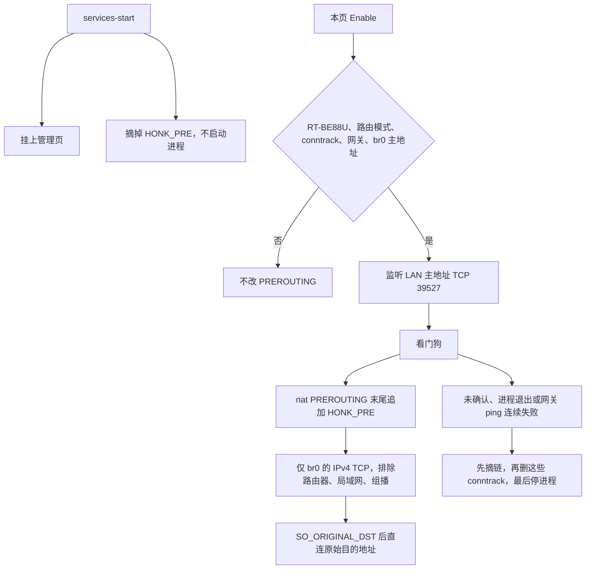

# honk on RT-BE88U（Asuswrt-Merlin）

这是把 honk 接到 RT-BE88U 的第一阶段。硬件加速不是目标。eBPF 数据面留在 `honk-core` 里，本插件在 Broadcom 4.19 上只安装 IPv4 TCP 的 iptables REDIRECT，并把连接直接转到原始目的地址。

## 已核对的平台

公开资料，不是在这台路由器上测到的：

- SNBForums 上的 amtm 输出：`ASUS RT-BE88U HW: aarch64 Kernel: 4.19.294`，固件 `3006.102.3`。
- Merlin `release/src/router/Makefile`：`HND_ROUTER_BE_4916` 默认 `LINUX_KERNEL=4.19.235`；只有 `ASUSWRT_BRCM_SDK_VERSION` 为 `WIFI7_SDK_20250506` 时才是 `5.15.167`。
- Merlin 树里的 `release/src-rt-5.04behnd.4916/kernel/linux-4.19/config_base.6a.6813` 文件头是 `Linux/arm64 4.19.294`。其中 `CONFIG_BPF=y`，但 `CONFIG_BPF_SYSCALL`、`CONFIG_CGROUPS`、`CONFIG_NAMESPACES` 都未打开。`CONFIG_IP_NF_TARGET_REDIRECT=y`。`CONFIG_NETFILTER_XT_TARGET_TPROXY=m`，同时 `CONFIG_NF_TPROXY_IPV4` 未打开，所以不能把 TPROXY 当成可用。`CONFIG_TUN=m`。`CONFIG_NF_CT_NETLINK=y`，`CONFIG_IKCONFIG_PROC=y`。
- 插件页用的是 Merlin `helper.sh` 的 `am_get_webui_page` / `am_settings_set`，以及 `services-start`、`nat-start`、`firewall-start`、`service-event`。当前 `menuTree.js` 里没有 `Tools_OtherSettings.asp`。页签插在只出现一次的 `Advanced_System_Content.asp` 后面，也就是管理页（`<#menu5_6#>`）。

CPU 是 aarch64。交叉编译目标是 `aarch64-unknown-linux-musl`。

## 架构



`nat-start` 只有在这次开机已经武装过时才会重新挂上链。它不读网页里保存的开关。`firewall-start` 的参数是 WAN 口，这个钩子不改 iptables。

路由器自己发出的包不进 `PREROUTING`，所以没有 OUTPUT 规则，也没有 `ip rule`。REDIRECT 在 PREROUTING 上会把目的地址改成入接口的主地址，不是 127.0.0.1，所以进程绑在 `lan_ipaddr` 上。

## 这一阶段做了什么

| 项 | 状态 |
| --- | --- |
| 内核配置探测：eBPF 偏好与 Merlin 安装动作分开 | 已实现，有测试 |
| IPv4 TCP REDIRECT 计划：先写满排除规则，最后才挂到 PREROUTING | 已实现，有测试 |
| 绑定 LAN 主地址，读 `SO_ORIGINAL_DST`，失败就关掉这条连接 | 已实现 |
| 把字节拷到原始目的地址 | 已实现。这不是代理 |
| 开机默认关闭、确认倒计时、网关 ping、进程退出后摘链 | 已实现，脚本测试 |
| 按 conntrack 原始元组删除被 REDIRECT 的流，不做 `conntrack -F` | 计划已按抓到的 `/proc/net/nf_conntrack` 行测试。本环境的 conntrack netlink 调用失败，删除命令没有在内核里跑通 |
| 管理页，沿用 FormTitle / FormTable / button_gen | 已实现。没有在浏览器里打开过 Merlin |
| 安装、卸载、`service-event` | 已实现，脚本测试 |
| aarch64 musl 交叉编译 | 有 `merlin/build.sh` 和 `.github/workflows/merlin.yml` |
| 通过 honk-outbound 拨代理节点 | 未接。`dial_honk_outbound` 固定返回错误，接受连接的路径不会调用它 |
| UDP、TUN、TPROXY | 只出现在探测结果里。插件不加载、不安装 |
| 启动 `honk-core` 的 eBPF | 不做 |
| IPv6、访客网络桥 | 不拦截，直接通过 |
| Broadcom flow cache / runner | 不改 nvram，不在运行时关闭 |

本仓库里没有 OpenWrt LuCI 页面。OpenWrt 只出现在 BTF 和安装说明里，那些说明没有删。

## 安全边界

- 每次开机 `services-start` 都会摘链并清掉 `/tmp` 里的武装标记。保存过的设置不会在开机后自动拦截。
- Enable 之前要同时满足：`productid` 或 `odmpid` 是 `RT-BE88U`，`sw_mode=1`，`conntrack -C` 成功，WAN 网关是一个 IPv4 地址，`lan_ifname` 的主地址等于 `lan_ipaddr`。
- 链里的规则都带 `-i` 局域网接口和 `-p tcp`。目的地址属于局域网、路由器自己的地址、127/8、169.254/16、224/4 或 255.255.255.255 时 RETURN。
- 确认倒计时默认 5 分钟，可选 1、2、5、10、15、30。确认之后倒计时停止，进程退出和 ping 失败仍然会摘链。
- 路由器上的 ping 不经过这条 PREROUTING 规则，它不能证明局域网电脑还能上网。确认按钮才是人工检查。
- 卸载脚本不依赖二进制也能摘链。它只删 `custom_settings.txt` 里 `honk_` 开头的行。

## 编译

在仓库根目录：

```sh
sh merlin/build.sh
```

产物是 `merlin/dist/honk-be88u.tar.gz`。里面是静态 musl 的 `honk-dataplane`、脚本和管理页。

## 在路由器上怎么试

这里没有连到路由器。下面的步骤是给持有这台 BE88U 的人在机器上做的，顺序不要换。

1. 先留下一个已经登录的 SSH。不要只靠网页管理。
2. 核对 `nvram get productid`、`nvram get sw_mode` 和 `uname -m`。型号应是 `RT-BE88U`，模式应是 `1`，架构应是 `aarch64`。
3. 执行 `conntrack -C`。如果失败，先安装 conntrack 用户态工具再继续。没有它时 Enable 会拒绝，并且不会往 PREROUTING 加规则。
4. 把压缩包解到 `/jffs/addons/honk`，执行 `sh /jffs/addons/honk/scripts/install.sh`。装完只应多一个管理页，局域网访问应当和安装前一样。
5. 用另一台电脑打开 Administration - Honk。Runtime 应是 `off`。把确认时间改成 1 或 2 分钟。
6. 点 Enable。再用那台局域网电脑打开一个网站。这一阶段应当仍打开原来的网站，而不是走到代理节点。
7. 网站和 SSH 都正常时，点 Confirm。不正常就不要再点，等倒计时结束。看门狗会摘链、删除转到监听端口的 conntrack，然后停进程。
8. 也可以立刻执行 `sh /jffs/addons/honk/scripts/uninstall.sh`。重启之后拦截应再次关闭。

## 未决问题

- 固件是否自带 `conntrack` 命令。内核有 `CONFIG_NF_CT_NETLINK`，用户态工具不一定在。
- 更新的 SDK 可能把 BE88U 切到 5.15。探测能看出来，插件仍然不会加载 eBPF。
- Broadcom flow cache 如果把转发从 netfilter 旁路掉，规则会装上但流量不变。本阶段故意不写 `fc` / `runner` 的 nvram。
- 菜单锚点写死在当前 Merlin `main` 的管理页。锚点不是恰好一行时，安装不会改 `menuTree.js`。
- 直连转发只适合确认“打开开关不会把网切断”。代理节点要等下一阶段把 `dial_honk_outbound` 接上。
